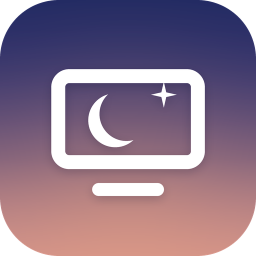
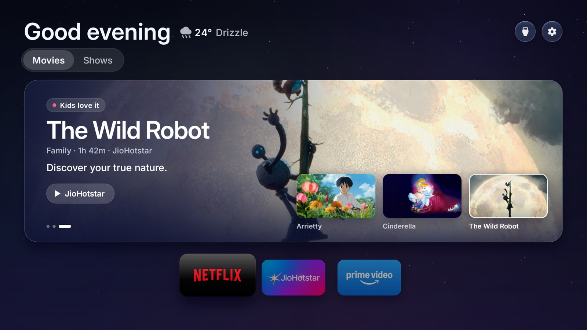
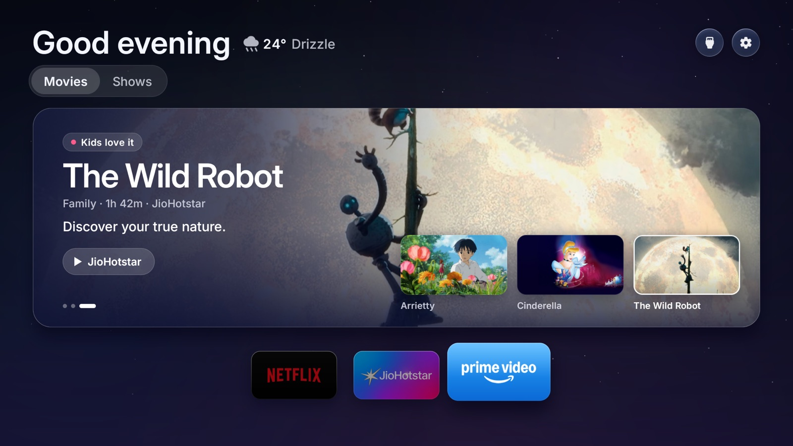

<p align="center"></p>

<h1 align="center">My Kids TV</h1>

<p align="center"><b>A calm, ad-free home screen for your child's TV, with only the films and shows worth their time.</b></p>

<p align="center">
  
</p>

The stock home screen on most TVs is built to keep everyone watching: ads, autoplay, whatever is trending. My Kids
TV replaces it with something made for a child. One title at a time, picked for their age from a catalog where every
title earned its place: fun to watch, well made, and leaving something behind.

It runs on **Google TV and Android TV**, and as an app on **LG (webOS)** and **Samsung (Tizen)** TVs. It is free,
open source, and nothing about your child ever leaves the TV.

## What your child sees

- **One title, shown well.** A large window with the picture, the name, the story in one line, and why it's worth
  watching: *Must-watch*, *Learn something* or *Kids love it*. Three thumbnails under it show what's next.
- **Something new every few seconds, never in their face.** The window moves on every 10 seconds and a fresh set
  arrives every 30. The moment your child picks up the remote, everything holds still so they can choose.
- **Movies and Shows**, from the catalog for their age: **4-6**, **7-10** or **11-13**.
- **Only what you can play.** A title appears only if it's on an app you have (Netflix, Prime Video, JioHotstar,
  Disney+, ...), and opens straight in that app. Once your child opens a title, it isn't suggested again.
- **A quiet night sky**, a greeting with their name and the weather, and your apps underneath. Press down for the
  week's weather, your HDMI input and the settings.
- **A screensaver** after 10 minutes without a key press: the titles' pictures full screen, slowly drifting, with the
  time.

<p align="center">
  
</p>

## What you control

Everything below sits behind a **parent PIN**.

| | |
|---|---|
| **Age** | Switch between 4-6, 7-10 and 11-13 at any time. |
| **The YouTube button** | Make the remote's YouTube button do nothing (Haier, TCL, Hisense, Sony). The app itself stays. |
| **Apps** | Choose which apps sit on the home screen; hide the ones your child shouldn't see (turned off, never uninstalled). |
| **Sleep timer** | Turn the TV off after 5 minutes to 4 hours, with the time left on screen. |
| **The way back** | *Original* restores the TV's own home screen and everything that was turned off. No root needed. |

**Privacy:** no ads, no accounts, no tracking. The app talks only to TMDB (titles and pictures) and Open-Meteo
(weather). What your child opened is remembered on the TV and nowhere else.

## How titles are chosen

| Age | Titles | For example |
|---|---|---|
| 4-6 | 86 | *My Neighbor Totoro*, *Bluey*, *Paddington 2*, *The Magic School Bus*, *Finding Nemo* |
| 7-10 | 314 | *Coco*, *The Iron Giant*, *Planet Earth*, *Avatar: The Last Airbender*, *Wolfwalkers*, *Taare Zameen Par* |
| 11-13 | 400 | *Princess Mononoke*, *Interstellar*, *To Kill a Mockingbird*, *The Man Who Knew Infinity*, *Dangal* |

1. **Wide search.** Best-of lists (Common Sense Media, BFI, children's film awards), sweeps of
   [TMDB](https://www.themoviedb.org), and TMDB's recommendations for every title kept: about 4,800 candidates.
2. **Hard rules.** Official age ratings, enough votes, a good audience rating.
3. **Judged one by one.** [Jev](https://typesafe.ai), TypeSafe's System One model, rates each title for that age:
   right for the age, lasting value, must-watch, how much a child will enjoy it and, from 7, how well it's made.
4. **A clear policy, in code.** Mostly English-language titles plus the outstanding few from elsewhere; the best
   come up most often; the famous ones every family has seen come up only now and then.
5. **A person reviews** every borderline title before it ships.

Every candidate, judgment and decision is in [`catalog/`](catalog/), so any choice can be read, questioned and changed.
The lists are also an [open dataset](data/) (CSV and JSON, CC BY 4.0) for parents, schools and developers.

## Set it up

About twenty minutes. You need the TV and a computer on the same Wi-Fi.

1. **On the TV:** Settings → System → About → press *Build* 7 times. Then Developer options → **USB debugging** on.
   Note the TV's IP address (Settings → Network & Internet).
2. **On your computer:** open an AI coding assistant ([Claude Code](https://claude.com/claude-code), Codex, ...) in
   this folder and say:
   > Set up My Kids TV on our TV at 192.168.1.50 for my 8-year-old.

   It asks a few questions (age, first name, city, the streaming apps you pay for, a parent PIN, the YouTube button),
   builds the app and installs it, asking before anything important.
3. **On the TV:** open *My Kids TV* → *Home Screen* → *My Kids TV*, and allow USB debugging when asked.

You'll need a free [TMDB API key](https://www.themoviedb.org/settings/api) for the titles. It stays on your computer
and your TV. Optional: put a `child-photo.png` next to `build.sh` to show your child's picture in the settings; it is
packed into your own build only and never committed.

## For developers

```
app/        Android TV app (Java, no Gradle): HomeView draws the home screen, Recs picks the titles
web/        The same home screen for LG and Samsung (HTML, CSS, ES5)
webos/      LG package          tizen/   Samsung package
catalog/    The catalog pipeline: candidates → rules → Jev → policy → review
data/       The open dataset
tools/      check.sh (all builds and translations), translate.py (25 languages), webapp.py
docs/       TECHNICAL.md: builds, adb and every TV brand's quirks
```

```bash
./build.sh            # MyKidsTV.apk (JDK 17 and the Android command-line tools)
tools/check.sh        # Android build, 25 translations, LG and Samsung packages
TYPESAFE_API_KEY=... python3 catalog/pipeline.py --band 7-10 all   # rebuild a catalog
```

The design principles are in [PRODUCT.md](PRODUCT.md); the setup flow an AI assistant follows is in
[CLAUDE.md](CLAUDE.md). Issues and pull requests are welcome.

**Status:** running daily on a Haier Google TV (Android 14). The LG and Samsung apps build and pass the checks, and
still need a run on real TVs.

## Credits

- Titles, pictures and availability: [TMDB](https://www.themoviedb.org). *This product uses the TMDB API but is not
  endorsed or certified by TMDB.*
- Title judgments: Jev by [TypeSafe](https://typesafe.ai). Weather: [Open-Meteo](https://open-meteo.com).
- MIT License, see [LICENSE](LICENSE).

Thanks to [Free My TV](https://github.com/simbasjungles/free-my-tv) for the inspiration and the open-source code My
Kids TV grew from.
